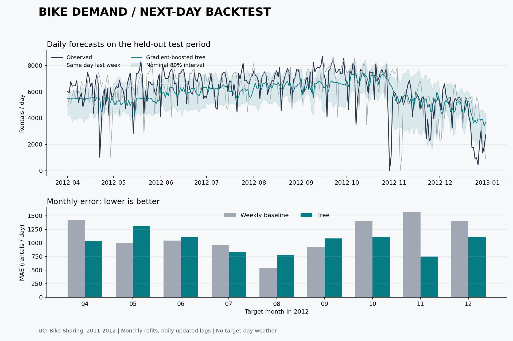

# Bike Demand Backtesting

A small, AI-assisted portfolio project for Moustafa Zaalouk. Predict daily
Capital Bikeshare rentals from past demand and known calendar information,
then check whether more complex models actually beat simple baselines.

**Main result:** the one-day LightGBM model improves MAE over the weekly
baseline, but loses to yesterday's demand. At seven days, it loses to the
weekly baseline. The nominal 80% prediction intervals cover only about 60%
of test observations. This is an honest forecasting experiment, not a
production-ready system or a claim of advanced model performance.



## Reproduce

Tested locally on Linux with Python 3.10.12. Python 3.10 is the reference
runtime. No account, GPU, paid API, or network access is needed after setup.
The small original daily CSV is included with attribution.

```bash
python3.10 -m venv .venv
. .venv/bin/activate
python -m pip install -r requirements.lock
python -m pip install --no-deps --no-build-isolation -e .
make train && make eval
make test && make lint && make smoke
```

After installation, `make reproduce` is the one-command full experiment,
plots, tests and lint run. Or use `make train && make eval` for the requested
two-stage workflow. Fixed seeds, single-thread model training, pinned direct
and transitive dependencies, and a dataset SHA-256 support reproducibility.
Exact floating-point bytes are not promised on other operating systems or
library builds. The CI workflow runs lint, tests and a short, date-subsampled
train/eval job. The workflow is now published; check the repository Actions tab for the current run status.

Optional source re-download, with a checksum check before replacing the CSV:

```bash
python -m bike_backtest.download
```

Rebuild the plot without retraining:

```bash
python -m bike_backtest.plot --results results
```

## Forecast contract and leakage controls

The project uses **day.csv only**, with 731 consecutive dates from January 1,
2011 through December 31, 2012. It does not claim hourly results. The requested
24-hour and seven-day horizons are represented by one and seven calendar
days; a one-hour horizon cannot be evaluated from this daily input.

For target day D and horizon h, the forecast is issued immediately after the
complete D-h daily count becomes available. Operationally, the one-day case
is a midnight next-day planning forecast, not a forecast issued before the
previous operating day has finished. No data-publication latency is modeled.

Allowed inputs:

- Target-date weekday and annual sine/cosine, elapsed days, holiday and
  working-day flags. The archived holiday schedule is assumed known ahead.
- Demand at D-h, D-(h+6), and D-(h+13).
- Seven- and 28-day averages, and seven-day population standard deviation,
  all ending at D-h.

The feature names `lag_1`, `lag_7` and `lag_14` refer to their offsets in the
one-day setup. At seven days their actual lags are 7, 13 and 20 days. This
keeps the weekly baseline separately defined as D-7 for both horizons.

The model never reads target-day actual weather, future weather, `casual`,
`registered`, `instant`, or current `cnt` as an unshifted feature. In the
source data `casual + registered == cnt`, so using those columns would be
an exact target leak. Weather is omitted entirely rather than pretending
that recorded future weather is an archived weather forecast.

### Rolling-origin protocol

1. Initial historical data: 2011. The first 28 days (34 for h=7) are warm-up
   rows, not model training examples, because full lag windows are required.
2. Validation: January 1 through March 31, 2012. Select the lowest validation
   MAE from three small LightGBM configurations separately for each horizon.
   There is no random split and no test metric enters selection.
3. Final test: April 1 through December 31, 2012, 275 daily predictions per
   horizon. Refit on an expanding history at the information cutoff of the
   first target in each month, then keep model parameters fixed that month.
4. Training labels end at first-target-minus-h days. All input windows end
   no later than each forecast's information cutoff. Earlier test labels
   may enter later refits only after they have been observed. Earlier days
   in a test month may update later forecast features. This is legitimate
   online evaluation, not a single untouched nine-month batch forecast.

`results/refit_audit.csv` records each fit's train and predict dates.
`results/test_predictions.csv` records every forecast, actual count,
information cutoff and training end date. Dates are sample identifiers;
there is no overlap between a given fit's training dates and evaluation
dates. Evaluation periods are disjoint. At h=7 forecasts overlap in time,
which makes daily errors dependent.

## Models and uncertainty

- **Persistence:** count at D-h.
- **Seasonal naive:** count at D-7. At h=7 these two baselines are identical.
- **Poisson regression:** scikit-learn PoissonRegressor with standardized
  features and fixed alpha=1.0. The scaler is fitted only on training data.
  This is a regularized count-mean model, not a negative-binomial fit or a
  distributional goodness-of-fit claim. Overdispersion is not diagnosed.
- **LightGBM:** trained from scratch, 200 trees, learning rate 0.05, no early
  stopping, with one of three validation-selected leaf/regularization pairs.
  No pretrained model or fine-tuning is involved.
- **Prediction intervals:** separate LightGBM 0.1 and 0.9 quantile models
  using the selected point-model configuration. Bounds are sorted per row
  to prevent crossing and clipped at zero. Nominal 80% is a requested level,
  not a coverage guarantee. No test-label calibration is performed.

Point metrics are MAE and RMSE (rentals/day), and WAPE (percent). WAPE is
sum absolute errors divided by sum observed counts, not MAPE. The interval
report includes empirical coverage, mean width and both pinball losses.
A 2,000-resample paired moving-block bootstrap (seven-day blocks, seed 42)
gives a descriptive interval for the MAE gain over seasonal naive. It is
conditional on this experiment, not a future-performance guarantee, and
does not include model-selection uncertainty.

## Measured results

Generated from `results/metrics.json` by `python -m bike_backtest.report`.
Every metric is computed by `src/bike_backtest/run.py` from exported test
predictions. `tests/test_core.py` independently recomputes committed point
metrics and coverage. See [RESULTS.md](RESULTS.md) for the full table,
interval metrics and interpretation. See `results/monthly_metrics.csv` for
per-month and per-horizon errors, including months where models fail.

## How it works, in plain language

1. Check that the daily file has the expected hash, a complete ordered
   calendar, binary calendar flags and nonnegative integer labels.
2. Move the demand column backward in information time before calculating
   rolling averages. Thus a feature row for tomorrow can contain today's
   completed count, but never tomorrow's count.
3. Train on earlier dates, forecast later dates, advance the origin, repeat.
   Try three tree settings on validation only; lock the choice before test.
4. Compare each prediction against the actual count and simple baselines.
   Plot the forecasts and monthly errors, including bad months.

An interview explanation: "I treated forecasting as a time-availability
problem first. I used only information available at each forecast origin,
not the recorded weather for the day I was predicting. I used chronological
validation and found that a complex model did not consistently beat simple
baselines. The interval undercoverage is another reason not to deploy it."

## Tests and repository map

Tests check exact lag/rolling values by hand, future-target perturbation
invariance, exclusion of weather and target components, exact weekly baseline
values, actual training-label dates and values, seven-day information gaps,
no train/predict date overlap, integer labels, schema/calendar integrity,
file tampering, hand-calculated MAE/RMSE/WAPE, constant-gain bootstrap bounds,
and agreement between committed metrics and predictions. Tests inspect
correctness, not only tensor or table dimensions.

```text
src/bike_backtest/core.py       features, validation, models, backtesting
src/bike_backtest/run.py        validation selection and test evaluation
src/bike_backtest/plot.py       plot from exported predictions
src/bike_backtest/report.py     measured-results Markdown from metrics JSON
src/bike_backtest/download.py   checksum-pinned source download
tests/test_core.py             correctness and leakage tests
data/day.csv                  unmodified attributed daily dataset
results/                      measured metrics, forecasts, audit, plot
.github/workflows/ci.yml       lint, tests, subsampled smoke experiment
```

All Python source uses four-space formatting, enforced by Ruff.

## Limits and next steps

Only two years in one historical city system. Demand growth, unusual events
and weather shocks can break patterns. A trend feature in a tree does not
provide reliable extrapolation beyond observed training values. Holiday
calendar availability is assumed rather than replayed from publication
archives. Data release delays, station-level inventory, rebalancing, costs,
real-time operations and deployment monitoring are not modeled. The test
set is sequential and adaptive, not independent identically distributed.

The one-day tree beats seasonal naive but not persistence; the seven-day
tree does not beat seasonal naive. Neither result supports a claim that
LightGBM is the best approach. Undercoverage means the raw quantile bands
are not safe operational uncertainty estimates. Future work could add
archived weather forecasts, seasonal linear models, overdispersion checks,
and validation-only interval calibration. These are proposals, not work
claimed complete. No employment, production or business-impact claims are
made. The project is AI-assisted and should be studied and reviewed before
being presented as personal work.

## Data and software attribution, separate from code license

**Project code:** MIT, see [LICENSE](LICENSE). This does not relicense the
data or third-party packages. No pretrained weights are included.

**Dataset:** Hadi Fanaee-T, *Bike Sharing* (2013), UCI Machine Learning
Repository, DOI https://doi.org/10.24432/C5W894.
Current dataset page: https://archive.ics.uci.edu/dataset/275/bike+sharing+dataset
Archive download: https://archive.ics.uci.edu/static/public/275/bike+sharing+dataset.zip
The current UCI page was checked on November 24, 2026 and explicitly states
Creative Commons Attribution 4.0 International (CC BY 4.0):
https://creativecommons.org/licenses/by/4.0/legalcode . The included daily
CSV is unmodified; derived features and results are newly generated.
See [data/ATTRIBUTION.md](data/ATTRIBUTION.md) for the verification record.

Original study: Hadi Fanaee-T and Joao Gama, "Event labeling combining
ensemble detectors and background knowledge," *Progress in Artificial
Intelligence* (2013), https://doi.org/10.1007/s13748-013-0040-3 . The source
README attributes the underlying rental logs to Capital Bikeshare and
weather information to Freemeteo.

**Model/software credits:** Microsoft and LightGBM contributors, LightGBM
(MIT): https://github.com/microsoft/LightGBM/blob/v4.5.0/LICENSE .
Scikit-learn developers, scikit-learn (BSD-3-Clause):
https://github.com/scikit-learn/scikit-learn/blob/1.5.2/COPYING .
NumPy, pandas and Matplotlib and their contributors provide the numerical,
table and plotting libraries. Their separate licenses remain applicable;
see installed distribution metadata. The repository does not redistribute
these libraries. Algorithms are fitted locally from scratch.
